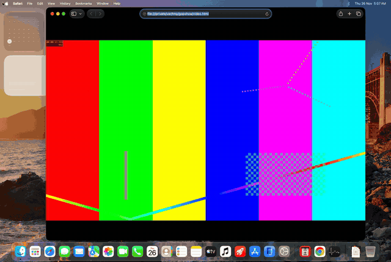
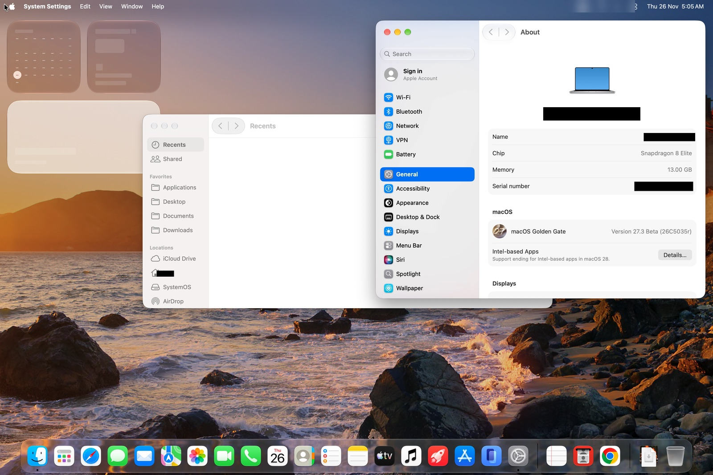
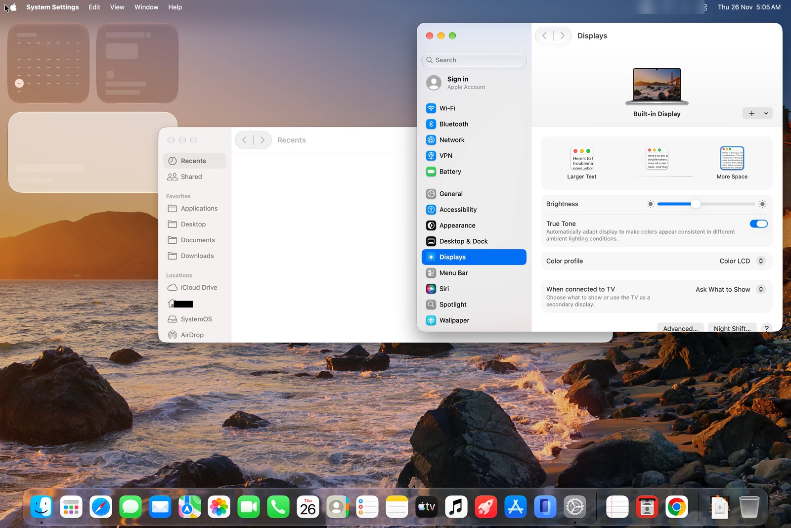
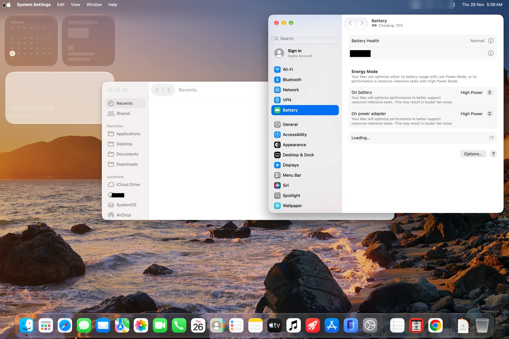
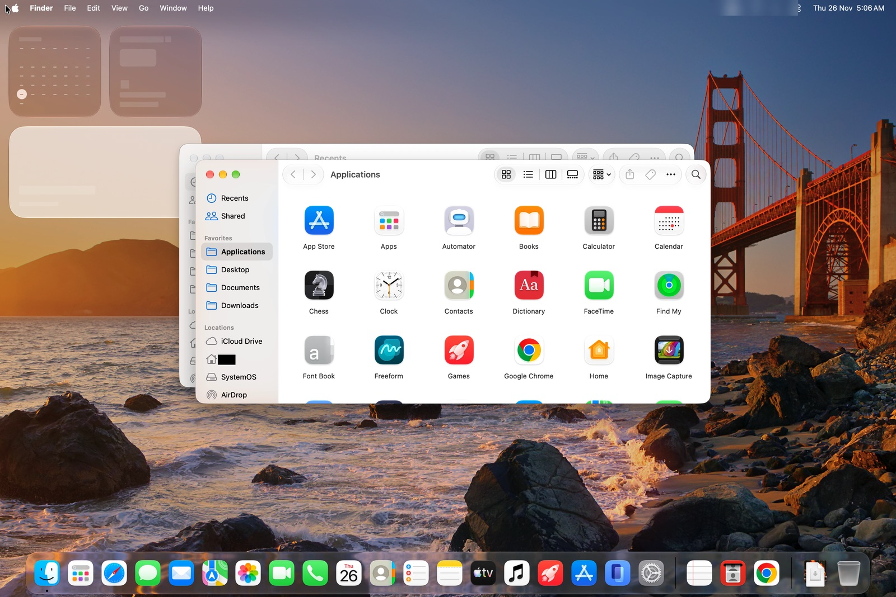
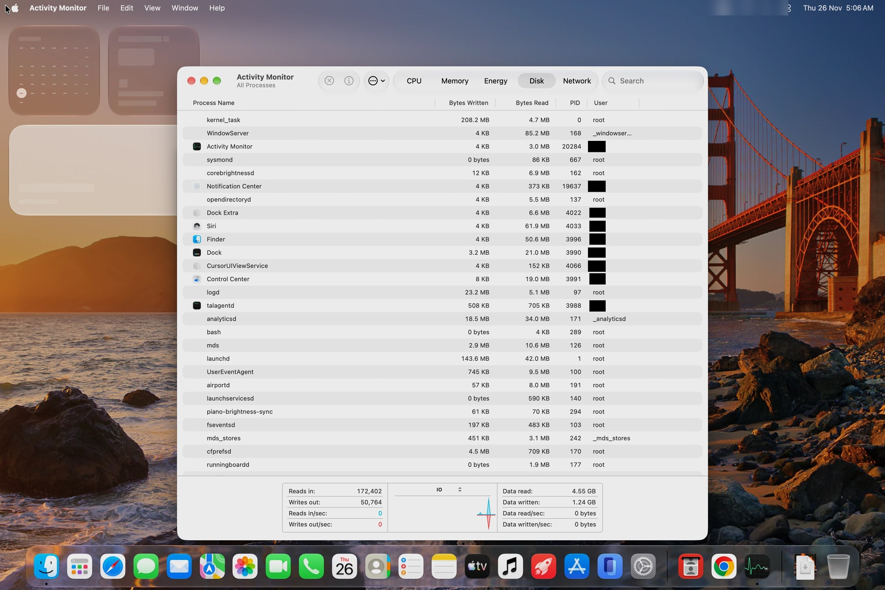
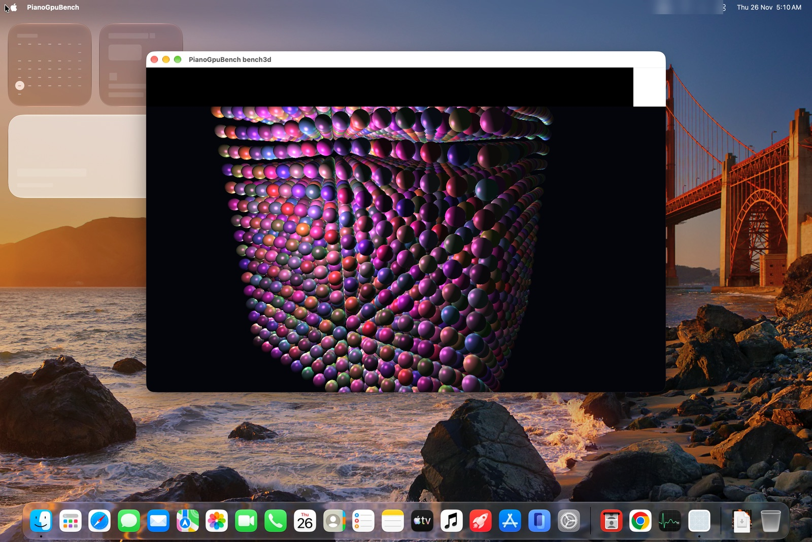
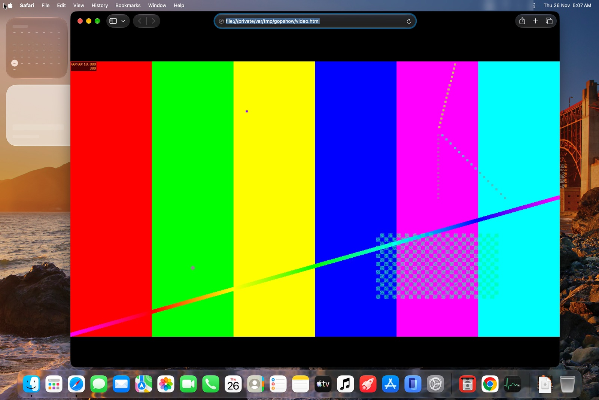
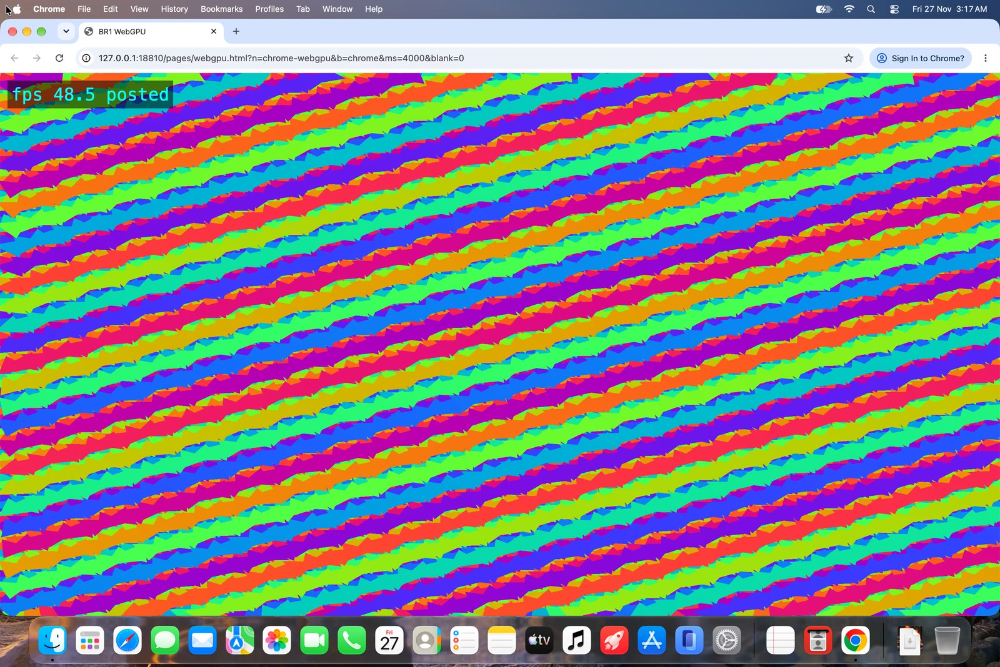

English | [简体中文](STATUS.zh-CN.md)

# Support status (2026-11-27)

One row per feature. Every status comes from a run on the tablet; host tests, analyses and "built, not run" work do not count.

- **Works (installed)**: verified on the system installed on the tablet's disk, booted from disk.
- **RAM only**: verified on a `fastboot boot` RAM image, not yet on the installed system.
- **Partial**: works, with the gaps named in the note.
- **Not yet**: not working, or never run on the tablet.

The installed daily build is **v13.1y12q** (2026-11-26). Data concurrent mode and USB debug network TX flow control are on by
default. The display stays at 60 Hz, with Night Shift routing, native panel sleep and refresh switching off.
"Verified" names the build and date of the run that showed the result. Daily results are in
[results-2026-11-27.md](results-2026-11-27.md), [results-2026-11-26.md](results-2026-11-26.md) and the earlier
`results-*.md` pages.

RAM `v131y12u-ram2` passed the 27-kext Batch 6/7 regression and established the read-only M5 display-sleep
baseline with `piano-dpu-panel=0`. The M5 fix-image gate remains **HOLD** pending the `piano-dpu-panel=1`
dark-wake observation. [RAM results](results-2026-11-27.md#v131y12u-ram2-2026-11-27) ·
[M5 baseline](results-2026-11-27.md#m5-read-only-dsi-pllphy-baseline)

✅ fully supported · 🟡 partial / in progress · ❌ not supported

| Feature | Status | Verified (build, date) | Note |
| --- | --- | --- | --- |
| Boot from disk, persistent install | ✅ Works (installed) | v13.1y12q, 2026-11-27 | Four consecutive disk boots reached the login window at +32 s and verified that the owner's Data store resumed. The `inst-y12q-obs3` console confirmed `cs-native4k-skip=1` with 896 files and 7496 MiB skipped. Installs write only changed parts after backups, verify them by reading them back, and support rollback to the previous build. [Boot results](results-2026-11-27.md#installed-boot) |
| Display | ✅ Works (installed), 60 Hz | installed v13.1y12q, 2026-11-26 · RAM v131y12t-qual1 and y12t-obs1, 2026-11-27 · RAM v131y12u-m2opt2, 2026-11-27 | PianoDpu flips on the boot framebuffer and native screenshots are enabled. Daily v13.1y12q has neutral colours at 60 Hz. DPU clock/RPMh readback passed on RAM. The full unlocked Night Shift `ns-base` sweep passed **RAM qualification** on `y12t-obs1` with zero apply failures. Both DSPPs returned to near-unity gains when switched off again. In M5R, the compression-route registers matched the bright desktop after wake, but the panel stayed dark. The fix-image gate is HOLD. Daily Night Shift routing stays OFF pending the owner's decision. Native panel sleep and refresh switching stay off in daily use. The fixed 120 Hz and 144 Hz profiles remain RAM-only. [Night Shift RAM results](results-2026-11-27.md#unlocked-night-shift-ns-base) RAM `v131y12u-m2opt2` earned **`M2 PASS` (`rc=0`)**. It skipped cache cleans on 99.96% of verified-WC flips and cut clean time per shown flip by 99.98%. Automated C920 checks found zero mismatches in six checks per arm. The recording had zero transient frames across 12,370 frames, and the reverse-order sanity check passed. M2 awaits install promotion. The daily default is OFF (`piano-dpu-clean-skip=0`) on installed v13.1y12q. [M2 RAM results](results-2026-11-27.md#v131y12u-m2opt2-2026-11-27) |
| 120 Hz / 144 Hz | 🟡 Partial | RAM v131y12t-m120d, 2026-11-27 · RAM m120c-144, 2026-11-26 | Dual-link fixed 120 Hz scanout stayed at 119.994 Hz with zero underruns and zero WindowServer crashes. The 144 Hz profile reached 144.146 Hz with the MM0 bandwidth vote and zero underruns. Both profiles are off by default. Under 120 Hz load, `pipe120` fell back on 511/511 swaps. App cadence was 50.71 callbacks/s, with zero `presentedTime` on all 3042 drawables. The `frame_info` audit flagged 3186/3187 missing records as `same_frame`. Both fix-image gates are **HOLD**. [120 Hz RAM results](results-2026-11-27.md#120-hz-pipe--presented-time-probe-ram-v131y12t-m120d) |
| Touch screen (native) | ✅ Works (installed) | v13.1y12l, 2026-11-26; gestures on RAM touch-native3, 2026-11-23 | A native built-in Touch Screen bound to the display: tap, long press (right click), pan and scroll in scroll views, pinch, rotate, smart magnify, palm rejection, 90 degree axes (44/0 on RAM). Installed: published from boot and acquired by the system. Long use by hand on the native path is pending. |
| Keyboard cover and trackpad | ✅ Works (installed) | owner hands-on, v12, 2026-11-19; v13.1y12l, 2026-11-26 | Typing and the trackpad work; the cover is known to the login window. |
| Wi-Fi | 🟡 Works (installed), partial | v13.1y12l, 2026-11-26; v13.1x, 2026-11-21 | Joins at boot (WPA2, DHCP, DNS); radio off/on from the switch rejoins; a forced link loss rejoins within seconds; country code set. Pending: joining by clicking a network row by hand, auto-rejoin after a hotspot goes away and comes back, and a multi-access-point office network. |
| Bluetooth | ❌ Not yet (in progress) | v13.1y12q, 2026-11-27; owner session on installed v13.1, 2026-11-20 | Installed preflight reported BT_PREFLIGHT READY (32/32 after 48 s), with the controller published and powered on and LE event mask bits 6 and 11 set. Discovery worked in the earlier owner session, but the LE connection timed out (HCI 0x08). Keyboard and mouse pairing awaits the owner's 20-minute hands-on session. Wi-Fi coexistence is under analysis. Bluetooth audio is open. |
| Speakers | ✅ Works (installed) | v13.1u, 2026-11-21 (audible tone); v13.1y12q, 2026-11-27 (read-only) · RAM v131y12u-ram2, 2026-11-27 | Playback, volume and mute work. Speaker protection at gain 243 and the stock Dolby "Movie" processing run on the DSP. Installs have been silent by request since 2026-11-23. The read-only daily check confirmed speaker and MiPlay readiness at timing profile 0. Concurrent playback and recording still need an active check. The opt-in silent `spk-probe1` passed in two consecutive RAM qualifications. All four amps reported `ok` at 25.0 °C and finished powered down. [Silent probe results](results-2026-11-27.md#second-silent-speaker-and-emission-free-ir-passes) |
| Microphone | 🟡 Partial | RAM y12t-obs1, 2026-11-27 · installed v13.1y12l, 2026-11-26 · noise reduction on RAM mic-ns4b, 2026-11-23 | Installed audio exposes the raw "Mic" (default input) and "Mic (noise reduced)" (RNNoise). The recording-during-playback stutter was fixed on the installed line on 2026-11-21. **RAM qualification** on `y12t-obs1` passed the calibrated −36 dBFS unattended AVFoundation app recording with zero clipped samples and passed C920 acoustic playback. Hands-on QuickTime and Voice Memos recording and playback on the installed system and the active installed duplex ledger remain open. [Mic RAM results](results-2026-11-27.md#calibrated-microphone-and-c920-playback) |
| Cameras: Photo Booth | ✅ Works (installed) | v13.1y12l, 2026-11-26 | Live front preview with no prompt; the effects grid opens. |
| Cameras: QuickTime | 🟡 Partial | v13.1y12l, 2026-11-26 | 10 s H.264 movies from the front and rear cameras record (AVFoundation, the QuickTime High preset). A New Movie Recording saved and played back by hand is pending. Encoding is in software. |
| Cameras: FaceTime | 🟡 Not yet verified | permissions pre-granted, v13.1y12l, 2026-11-26 | Both cameras are listed and FaceTime has Camera and Microphone access; a FaceTime self-view has not been checked. |
| Charging: 5 V | ✅ Works (installed) | v13.1y12d, 2026-11-24 | Up to 3 A from a 3 A source (input limit 3000 mA; on a computer port the input settles near 1.8 A when the bus sags to about 4.72 V); net battery charge current positive. |
| Charging: PD 9 V (buck) | ✅ Works (installed) | v13.1y12d, 2026-11-24 | On by default. Fixed 9 V PD on the stock charger: 9 V / 1.6 A (about 14 W, the current the charger firmware requests, as on Ubuntu). PPS 9 V (up to 2.5 A) is built but not run. |
| Charging: 80 % hold | ✅ Works | RAM chg-buck6, 2026-11-17; in every installed profile since | Stops at 80 %, resumes at 75 %. |
| Charging: charge pump / MiPPS | ❌ Not yet | first attended try, 2026-11-24 | Off by default. The first attempt stayed at a 100 mA input limit (an unmapped vendor power object); fixed in the build, the next attended test is pending. |
| Battery percentage | ✅ Works (installed) | installed ESP v2, 2026-11-14; RAM m120c-120, 2026-11-26; RAM v131y12t-qual1, 2026-11-27 | The installed system shows battery percentage and power state. On m120c-120, the battery registry reported 122 cycles, 9200 mAh design capacity and 8781 mAh full capacity. System Information showed 122 cycles and “Service Recommended” and omitted Maximum Capacity. The opt-in BH-2 RAM check published `AppleSmartBatteryPack`. Its gate is HOLD after the `powerd` persistent storage write returned `kIOReturnIOError`. |
| Sleep and wake | 🟡 Partial | v13.1y12m, 2026-11-26 (installed policy and RAM checks); RAM v131y12t-qual1, 2026-11-27 | The v13.1y12m checks recorded Wi-Fi and USB recovery and return to the lock screen after wake. The installed build arms the cover and power-key policy. The latest RAM qualification passed suspend-to-idle with timer wake and simulated power-key and lid policies. Earlier RAM checks covered charging with the lid closed (locks without suspending) and simulated power-key sleep and wake. The physical power key and closing the cover on battery still need attended checks. |
| Brightness: manual | 🟡 Partial | keys on installed v12, 2026-11-19; slider path on v13.1i | Brightness keys work. The slider path through the system's brightness control works; a hand drag in Control Center is pending. |
| Brightness: automatic | ✅ Works (installed) | v13.1y12l, 2026-11-26 | The light sensor drives automatic brightness; manual moves do not end automatic mode. A real light-change span is pending. |
| GPU: Metal (Adreno 830) | ✅ Works (installed) | v13.1y12l, 2026-11-26 | Our Metal plug-in runs WindowServer, the desktop and apps; ImageIO, Core Image on Metal, MetalKit texture loading and Quick Look thumbnails pass: 30 of 30 graded paths, including the 4032-pixel Core Image and HEIC texture paths that ran out of memory before; Preview opens a 4032-pixel photo. |
| GPU: paged memory | ✅ Works (installed) | v13.1y12l, 2026-11-26 | 4 KiB paged GPU memory (cap 7168 MiB, no fixed pool), no refusals, no page faults; hang recovery by replay on by default. |
| GPU: Android-level frequency curve | ✅ Works (installed) | v13.1y12q, 2026-11-27 · v13.1y12l, 2026-11-26 | Android's 14-level GPU table up to 1100 MHz, with skin and thermal limits and a KGSL-style governor, plus the Android CPU table. The installed 10-minute Metal 3D run averaged 59.98 fps at 967–1050 MHz with 0 GPU faults. FPS measures Metal completions (`presented=0`). [Sustained Metal 3D results](results-2026-11-27.md#sustained-metal-3d-installed-v131y12q) |
| GPU: 4 GiB windows | ✅ Works (installed) | v13.1y12l, 2026-11-26 | 64 client windows of 4 GiB in a 256 GiB aperture, 1 GiB per object, no GPU open refused. Fixes the Core Image 4032-pixel out-of-memory paths (Metal image check 30/30). |
| Safari: WebGL 2 and WebGPU | ✅ Works (installed) | v13.1y12o, 2026-11-26 | WebGL 2 and WebGPU passed again. On v13.1y12m, the WebGPU adapter was "adreno" and the test page ran at about 52 fps with correct readback. |
| Safari: hardware video decode | ✅ Works (installed) | v13.1y12o, 2026-11-26; v13.1y12i, 2026-11-25 | H.264 up to 1920x1088 decodes on the Iris video core. The 1080p test again reported zero dropped frames. |
| Safari: HEVC and 4K | ✅ Works (installed), software | v13.1y12j, 2026-11-25; HEVC replayed on v13.1y12o | HEVC 2160p 600/0 at 29.9 fps and H.264 2160p 591/5 on v13.1y12j, in Apple's software decoders. VP9 and AV1 are not supported. |
| Chrome: GPU acceleration | ✅ Works (installed) | v13.1y12q, 2026-11-27; v13.1y12o, 2026-11-26; earlier tests on v13.1y12m and v13.1y12l | Flags-free WebGL 2 measured 37.89 fps at 3200 × 1738 through ANGLE Metal (Adreno 830, `GraphiteDawnMetal`). Chrome played H.264 and HEVC at 1080p and 4K and VP9 and AV1 at 1080p with 0–1 dropped frames. HEVC went through VideoToolbox. The run recorded zero crashes, PianoA830 failures or sandbox denies. Earlier checks with the GPU sandbox on covered GPU compositing, canvas 2D at 56 fps and scrolling at 60 fps with no frame over 34 ms. Chrome can exhaust the RAM-backed Data disk on RAM boots. |
| Chrome: WebGPU | ✅ Works (installed) | v13.1y12q, 2026-11-27; v13.1y12o, 2026-11-26 | Without GPU, WebGPU or sandbox flags, 6/6 contexts opened on `qualcomm` / `adreno-8xx` (`fallback_adapter = false`), with correct compute and exact offscreen and canvas `bgra8unorm` pixel readback. Context-provider, ring-buffer and transfer-buffer errors were all zero. Kernel patch 0075 supplied 47-bit user VA. All 17 Chrome processes reported secure V8 sandbox mode (bucket 0) and a 1152 GB reservation. |
| Video playback (QuickTime) | ✅ Works (installed) | installed v13.1x, 2026-11-21 · RAM v131y12u-ram2, 2026-11-27 | AVC High and HEVC Main10 decoded in hardware; about 100 s each with 0 transient or dark frames on the webcam. The pending-cancel fix passed `video-v6 --qualify` on two consecutive RAM boots. The second passed 13/13 phases with `V6_TOOL_EXIT=0`, 4/4 terminal `Demt` callbacks and 30/30 frames after session recreate. Installed v13.1y12q predates the fix. [Video RAM qualification](results-2026-11-27.md#second-videotoolbox-cancellation-pass) |
| Energy modes | 🟡 Partial | v13.1y12l, 2026-11-26 | Low Power, Automatic and High Power (the daily setting) set with `pmset` reach the power and thermal policy. The picker in System Settings is not verified by hand. |
| Login window idle CPU | ✅ Works (installed) | v13.1y12l, 2026-11-26 | Fixed: an audio daemon looped at the login window (about 1.3 cores); it is now held until the login. |
| App launches | ✅ Works (installed) | v13.1y12l, 2026-11-26 | Calculator, TextEdit and Notes open their first window in under 2.5 s. |
| USB debug (console, root shell, ssh) | ✅ Works (installed) | installed v13.1y12q and RAM v131y12t-qual1, 2026-11-27; installed v13.1y12q, 2026-11-26 | USB-C debug console, root shell and SSH over the cable work. Patch 0076 lets the shell read boot arguments past the legacy 1024-byte cut. TX flow control is on by default since v13.1y12q and was active on the November 27 disk check. The November 27 RAM matrix passed 66/66 exact transfers with zero driver drops. |
| OS switcher (Android / macOS) | 🟡 RAM only, read-only | RAM v13.1y12e, 2026-11-24 | The boot-flag sysctls read the flag; writes are refused by design. A full switch has not been run. |
| USB host / OTG | ❌ Not yet | RAM usb-a2d, 2026-11-18 (empty port) | Host mode starts on an empty port; VBUS supply and a real device are not done. |
| External display (USB-C DP) | ❌ Not yet | none | Design only. |
| Auto-rotate and other sensors | ❌ Not yet | RAM v131y12t-qual1, 2026-11-27 | The light sensor works. The RAM check passed the accelerometer stream and the `piano-rotated` boot-argument read past 1024 bytes. Auto-rotate remains off in the daily profile and in analysis. |
| Hardware video encode (Iris VPU 3.5) | 🟡 RAM-only E1 self-test PASS | installed `v13.1y12q` · RAM `v131y12u-e1fix1`, 2026-11-27 | Installed recordings use software encoding. E1 defaults to off (`piano-video-enc=0`) and the VideoToolbox encoder inventory is empty (`encs=0`). The opt-in RAM kernel self-test passed H.264 hardware encode at 640×480, 10 frames and 2 Mbps. Post-E1 AVC decode passed 13/13 phases on the same boot using the resident Iris core. 720p/1080p hardware runs and VideoToolbox encoder registration (E2+) remain **HOLD** pending analysis. [E1 RAM results](results-2026-11-27.md#v131y12u-e1fix1-2026-11-27) |
| IR blaster, stylus, torch | 🟡 RAM-only bring-up (IR) | RAM v131y12u-ram2, 2026-11-27 | SE15 passed in two consecutive RAM qualifications. On `v131y12u-ram2` the survey made 0 stores and DMA loopback passed 64/64 bytes in 381 µs with GPIO29 held as GPIO and verified dark. `piano-ir status` confirmed ready with zero sends. Actual IR emission awaits an attended receiver check. Stylus and torch remain unsupported. [IR RAM results](results-2026-11-27.md#second-silent-speaker-and-emission-free-ir-passes) |
| Memory (16 GB) | 🟡 Partial | installed v13.1y12l and RAM m120c-120 and ram16g-hevc1, 2026-11-26 · RAM ram16g-hctl1, 2026-11-27 | The installed system uses 13 GiB (13310 MiB). At idle it had 47% free, with no compression, swap or memory pressure. The EFI audit classified 319/322 two-MiB slabs as non-runtime (CMA 128/128, DXE 184/186, FD 7/8), released 0 MiB and awaits owner verification. The 684 MiB mixed HEVC arena (274 MiB from region 0 and 410 MiB from XNU) passed its RAM reservation self-test. All 24/24 decoded 4K Main10 frames matched the golden P010 hashes, 12 on first open and 12 on resident reopen, with no video faults. The control passed HEVC admission checks and reproduced the AVC pending-cancel timeout with the mixed arena disabled. The GPU memory tier and driver pools remain in progress. [RAM16G control results](results-2026-11-27.md#ram16g-hevc-control-ram-ram16g-hctl1) |
| Internal storage (UFS) | 🟡 Partial | installed v13.1y12q and RAM scratch-window A/B, 2026-11-27; installed v13.1y12o and RAM scratch-window power-cut tests, 2026-11-26 | M4 concurrent mode starts after Data mounts on v13.1y12q. The installed A/B measured 4.9× and 5.6× serial 4 KiB random-read IOPS at QD8 and QD32. All three modes passed 32/32 in scratch-window power-cut tests. In the scratch-window speed A/B, M5-wb passed with 1.71×–4.12× M4-conc write throughput and 42%–58% lower sync p50. M5-queue failed with lower read IOPS and 401 inter-phase queue-full refusals. `data-store-write-back=0` and `data-store-queue=0` are the defaults on `main`. Daily write-back requires an owner decision and a fresh owner-store backup. Queue mode is unsuitable for daily use. [Scratch-window results](results-2026-11-27.md#disk-m5-scratch-window-ab) |
| Fingerprint, NPU | ❌ Deferred | none | No Secure Enclave (no Touch ID); no Core ML backend on this SoC. |

## Known gaps

- Bluetooth preflight is ready on the daily build. The owner's 20-minute keyboard and mouse pairing session is pending.
  Radio coexistence is under analysis, and Bluetooth audio remains open.
- Physical power-key checks, closing the cover on battery, the Energy Mode picker and hand-testing the brightness slider.
- Chrome on RAM boots.
- Charge pump / MiPPS fast charging; PPS 9 V.
- Fixed 120 Hz and 144 Hz scanout work on RAM. High-refresh app presentation and positive `presentedTime` at 120 Hz remain
  unverified. Swap-service pipelining awaits a RAM check on the tablet. Both fixed profiles and refresh switching are off by default.
- Night Shift routing stays OFF on installed v13.1y12q pending the owner's decision. The rehearsed v13.1y12t ESP-only
  install package remains on HOLD. Native panel sleep stays off and the M5 fix-image gate is HOLD after the panel stayed dark
  on wake. [Night Shift RAM qualification](results-2026-11-27.md#unlocked-night-shift-ns-base) · [M5R results](results-2026-11-27.md#ram-qualification)
- The opt-in BH-2 check is on HOLD pending the owner's decision on 27.3 `powerd` analysis. System Information showed
  “Service Recommended” and omitted Maximum Capacity in the earlier m120c-120 run.
- The EFI audit awaits owner verification and released 0 MiB. Mixed 4K Main10 HEVC passed on RAM. The GPU memory tier and
  driver pools remain in progress.
- Daily M5 write-back promotion awaits an owner decision and a fresh owner-store backup.
  [Scratch-window results](results-2026-11-27.md#disk-m5-scratch-window-ab)
- USB host devices, external display, auto-rotate (in analysis), VideoToolbox hardware encode (E2+), VP9/AV1 in Safari.
- Validation of the install guide on other units.
- The active installed duplex ledger and hands-on QuickTime and Voice Memos recording and playback remain open.
  The installed system also awaits QuickTime movie recording, FaceTime self-view, joining a Wi-Fi network from the
  menu and Wi-Fi auto-rejoin when the network returns.

## Showcase

Screenshots and short clips of the features above, taken on the tablet itself (native screen captures). Webcam footage is used
only where the physical view matters (rotation, touch). Every file is reviewed frame by frame before it is published: network
names, account names, notifications, serials and personal content are blurred or cropped, and metadata is stripped. The sources
of each file are listed in [media/SOURCES.md](media/SOURCES.md).

| Scene | Media | Status |
| --- | --- | --- |
| Safari video playback, a 12 s clip (24 native frames, 0.5 s apart) |  | ✅ native capture, v13.1y12m |
| About This Mac (Snapdragon 8 Elite, 13 GB visible, macOS 27.3) |  | ✅ native capture, v13.1y12m |
| Displays settings (built-in display, brightness, True Tone, Night Shift) |  | ✅ native capture, v13.1y12m |
| Battery settings (charging, Energy Mode High Power) |  | ✅ native capture, v13.1y12m |
| Desktop with Finder (Applications) |  | ✅ native capture, v13.1y12m |
| Activity Monitor (disk view) |  | ✅ native capture, v13.1y12m |
| Metal 3D demo (GPU benchmark scene) |  | ✅ native capture, v13.1y12m |
| Safari playing a test video (hardware decode) |  | ✅ native capture, v13.1y12m |
| Photo Booth live camera view | coming | native capture scheduled |
| Wi-Fi network list | coming | native capture scheduled (network names will be blurred) |
| Touch gestures (tap, pinch, rotate, scroll) | coming | the existing webcam recordings are out of focus; a new recording is needed |
| Rotation to portrait | coming | the existing webcam recordings are out of focus; a new recording is needed |
| Chrome with GPU acceleration |  | ✅ native capture, v13.1y12q |
