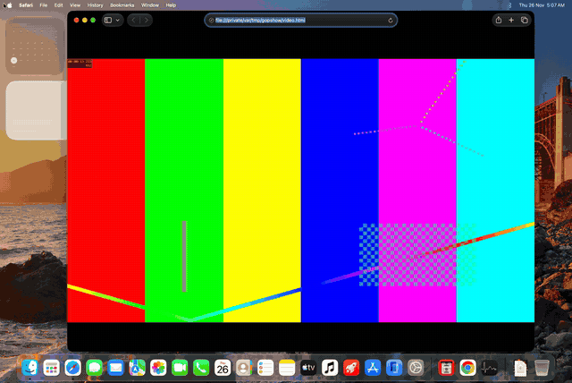
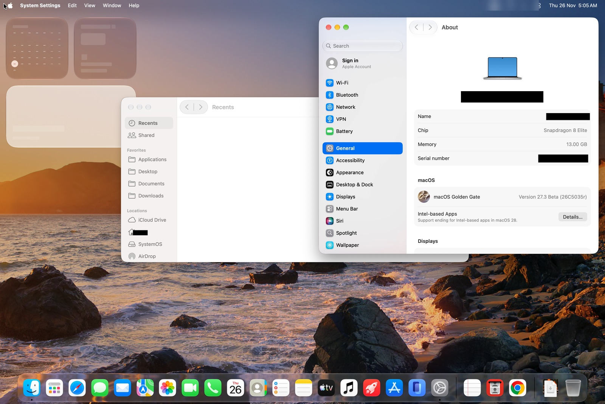
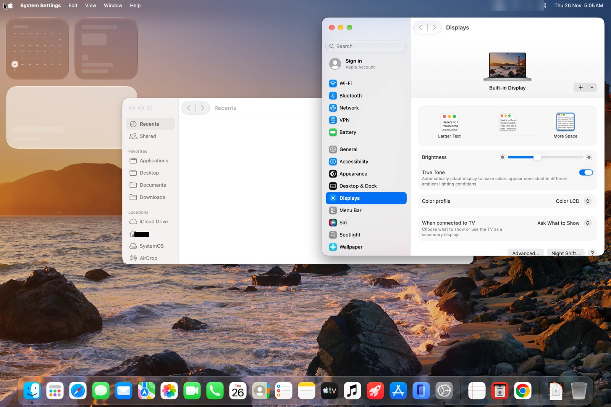
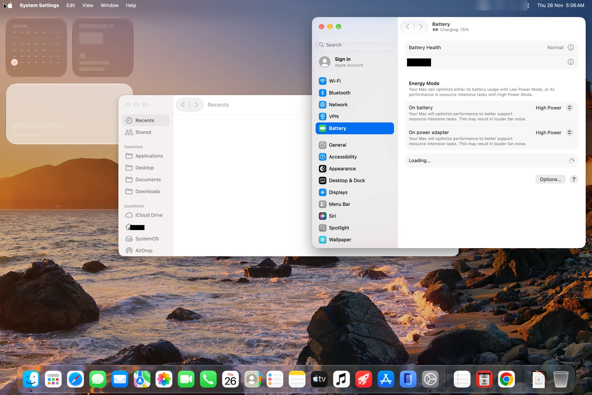
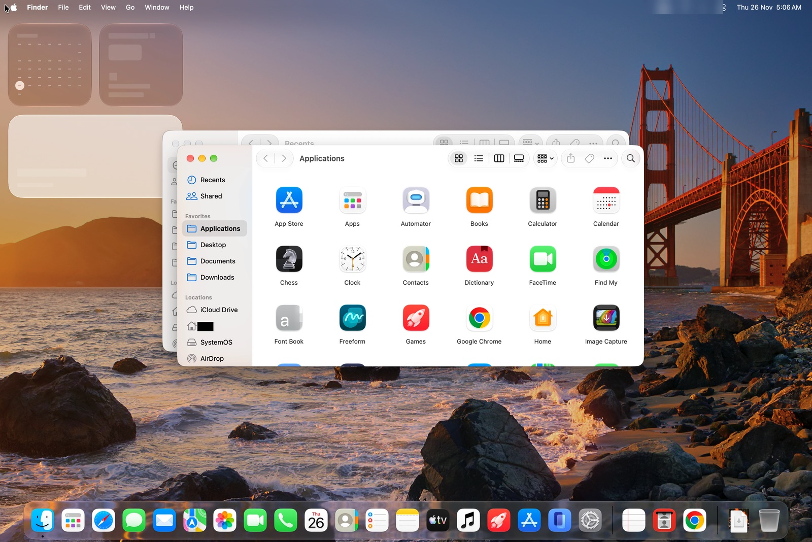
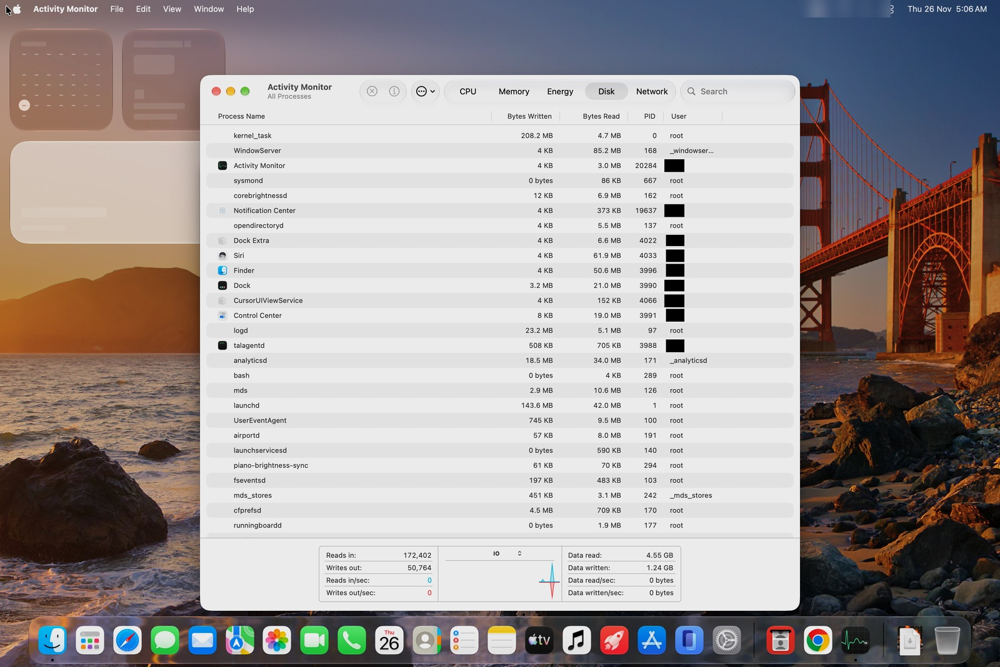
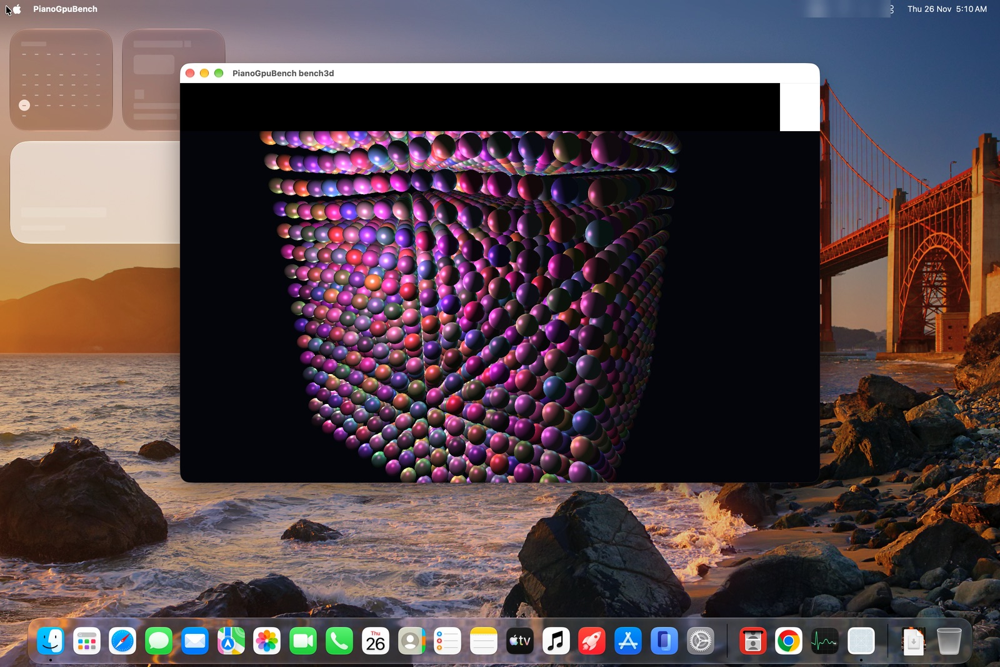
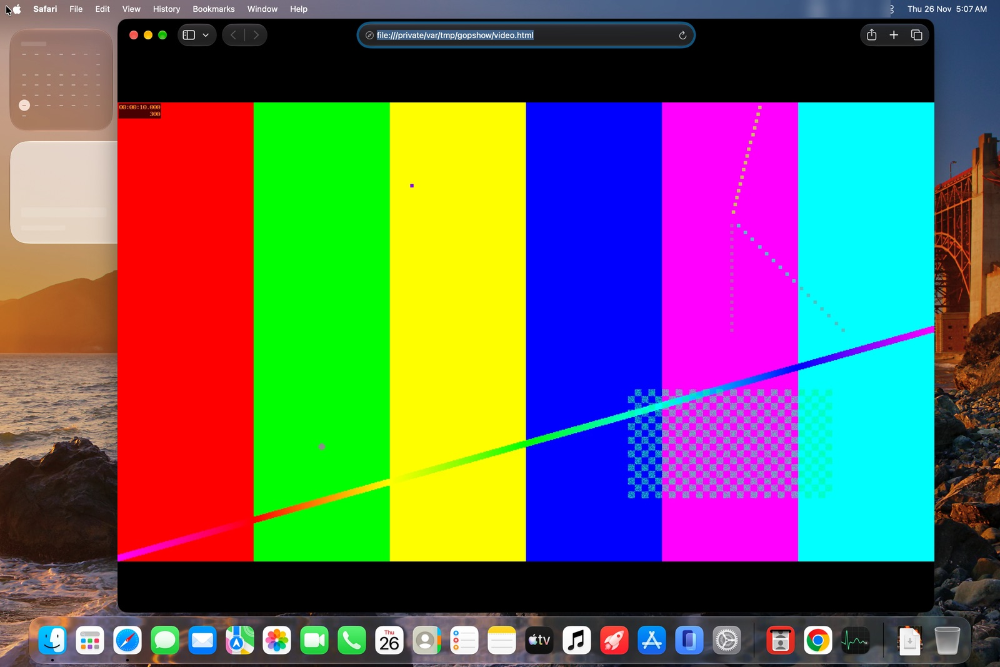
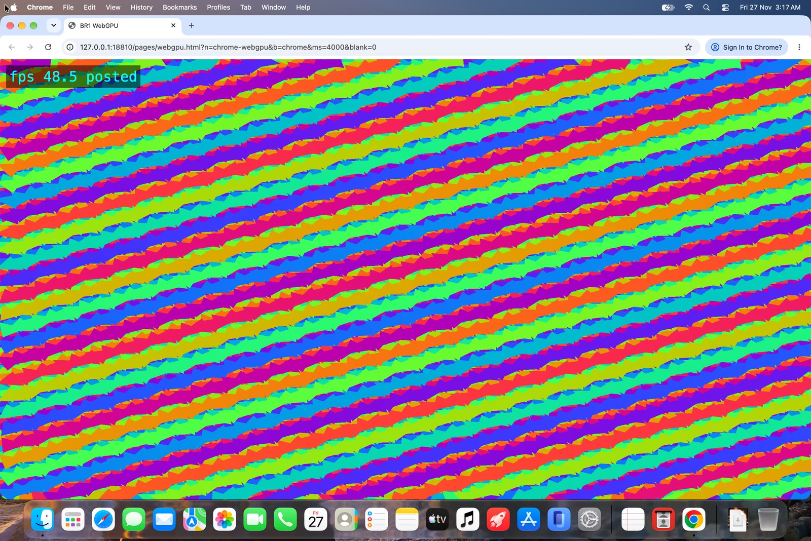

[English](STATUS.md) | 简体中文

# 支持状态（2026-11-27）

每项功能一行。所有状态都来自平板上的实际运行；主机测试、分析以及“已构建但未运行”的工作都不算。

- **可用（已安装）**：在安装到平板磁盘、从磁盘启动的系统上验证过。
- **仅 RAM**：在 `fastboot boot` 的 RAM 镜像上验证过，尚未在已安装系统上验证。
- **部分可用**：可用，但有备注中列出的缺口。
- **尚未支持**：不能用，或从未在平板上运行过。

当前已安装的日常版本是 **v13.1y12q**（2026-11-26）。Data 并发模式和 USB 调试网络发送流控默认开启。
显示保持 60 Hz，夜览路由、原生面板休眠和刷新率切换均关闭。
“验证”一栏列出取得该结果时所用的版本和日期。
每日结果见 [results-2026-11-27.md](results-2026-11-27.md)、[results-2026-11-26.md](results-2026-11-26.md) 及更早的 `results-*.md` 页面（英文）。

✅ 完整支持 · 🟡 部分支持 / 进行中 · ❌ 尚不支持

| 功能 | 状态 | 验证（版本，日期） | 说明 |
| --- | --- | --- | --- |
| 从磁盘启动、持久安装 | ✅ 可用（已安装） | v13.1y12q，2026-11-27 | 连续四次从磁盘启动均在 +32 秒到达登录窗口，并确认机主的 Data 存储已恢复使用。`inst-y12q-obs3` 的控制台确认 `cs-native4k-skip=1` 已生效，跳过了 896 个文件共 7496 MiB 的预哈希。安装先备份，只写入改动部分，写后回读校验，并可回滚到上一版。[启动测试结果](results-2026-11-27.md#installed-boot) |
| 显示 | ✅ 可用（已安装），60 Hz | 已安装 v13.1y12q，2026-11-26；RAM v131y12t-qual1 和 y12t-obs1，2026-11-27；RAM v131y12u-m2opt2，2026-11-27 | PianoDpu 在启动帧缓冲的管线上翻页，原生截图已开启。日常版本 v13.1y12q 以 60 Hz 显示，色彩中性。RAM 测试中，DPU 时钟和 RPMh 回读通过。在 `y12t-obs1` 的 **RAM 资格测试**中，屏幕保持解锁，夜览 `ns-base` 全程扫描通过，设置下发无失败。再次关闭夜览后，两路 DSPP 的增益均恢复到接近 1.000。M5R 唤醒后的压缩路径寄存器与亮屏桌面一致，但面板仍黑屏。修复镜像继续暂缓。日常版本的夜览路由保持关闭，等待机主决定。日常版本继续关闭原生面板休眠和刷新率切换。固定 120 Hz 和 144 Hz 配置目前仅在 RAM 启动下验证。 [夜览 RAM 测试结果](results-2026-11-27.md#unlocked-night-shift-ns-base) RAM 测试 `v131y12u-m2opt2` 达到 **`M2 PASS`（`rc=0`）**。经验证为 WC 的翻页有 99.96% 跳过缓存清理，每次显示翻页的清理耗时下降 99.98%。两组各完成 6 次 C920 自动光学检查，均无不匹配。记录的 12,370 帧中无瞬态异常，反序验证通过。M2 仍待纳入安装版。已安装的日常版本 v13.1y12q 默认关闭此优化（`piano-dpu-clean-skip=0`）。[M2 RAM 测试结果](results-2026-11-27.md#v131y12u-m2opt2-2026-11-27) |
| 120 Hz / 144 Hz | 🟡 部分可用 | RAM v131y12t-m120d，2026-11-27；RAM m120c-144，2026-11-26 | 固定 120 Hz 的双链路扫描稳定在 119.994 Hz，无接口供数不足（underrun），WindowServer 无崩溃。144 Hz 配置在启用 MM0 带宽投票后达到 144.146 Hz，无接口供数不足。两种配置默认关闭。120 Hz 负载下，`pipe120` 在 511/511 次帧交换中回退。应用每秒收到 50.71 次回调，3042 个 drawable 的 `presentedTime` 全为零。`frame_info` 审计发现，3187 条缺失记录中有 3186 条被标记为 `same_frame`。两项修复镜像均维持 **HOLD（暂缓）**。[120 Hz RAM 测试结果](results-2026-11-27.md#120-hz-pipe--presented-time-probe-ram-v131y12t-m120d) |
| 触摸屏（原生） | ✅ 可用（已安装） | v13.1y12l，2026-11-26；手势在 RAM touch-native3，2026-11-23 | 绑定到显示器的原生内置触摸屏：点按、长按（右键）、在滚动视图中拖动与滚动、双指缩放、旋转、智能缩放、防误触、90 度坐标（RAM 上 44 项通过 / 0 项失败）。已安装系统：开机即发布并被系统接管。原生路径的长期手动使用仍待验证。 |
| 键盘保护套与触控板 | ✅ 可用（已安装） | 机主实测，v12，2026-11-19；v13.1y12l，2026-11-26 | 打字和触控板可用；登录窗口能识别保护套键盘。 |
| Wi-Fi | 🟡 可用（已安装），部分 | v13.1y12l，2026-11-26；v13.1x，2026-11-21 | 开机自动连接（WPA2、DHCP、DNS）；开关关闭再打开后重新连接；强制断线后几秒内重连；国家码已设置。待验证：手动点击网络列表中的某一行加入、热点消失又恢复后的自动重连、多接入点的办公室网络。 |
| 蓝牙 | ❌ 尚未支持（进行中） | v13.1y12q，2026-11-27；机主在已安装的 v13.1 版本上测试，2026-11-20 | 已安装系统的预检报告 BT_PREFLIGHT READY（等待 48 秒后 32/32 项通过），控制器已发布并上电，低功耗蓝牙事件掩码第 6 和 11 位已设置。机主此前测试时能发现设备，但低功耗蓝牙连接超时（HCI 0x08）。键盘和鼠标配对仍待机主进行 20 分钟实机测试。与 Wi-Fi 的射频共存正在分析。蓝牙音频尚待实现。 |
| 扬声器 | ✅ 可用（已安装） | v13.1u，2026-11-21（有声测试音）；v13.1y12q，2026-11-27（只读）；RAM v131y12u-ram1，2026-11-27 | 播放、音量和静音可用。扬声器保护（增益 243）和原厂杜比 “Movie” 音效在 DSP 上运行。自 2026-11-23 起应要求静音安装。日常配置的只读检查确认时序配置 0 下扬声器和 MiPlay 均就绪。同时播放和录音仍待实际运行验证。 手动启用的静音探测 `spk-probe1` 在 RAM 上通过。四路功放均报告 `ok`，温度均为 25.0 °C，零回退，全程无可听声音。[静音探测结果](results-2026-11-27.md#silent-speaker-protection-probe) |
| 麦克风 | 🟡 部分可用 | RAM y12t-obs1，2026-11-27；已安装 v13.1y12l，2026-11-26；降噪在 RAM mic-ns4b，2026-11-23 | 已安装系统提供原始 “Mic”（默认输入）和 “Mic (noise reduced)”（RNNoise）。边播放边录音的卡顿已于 2026-11-21 在已安装版本线上修复。`y12t-obs1` 的 **RAM 资格测试**通过了校准为 −36 dBFS 的 AVFoundation 应用无人值守录音和 C920 声学回放检查，录音无削波。已安装系统上的 QuickTime 和语音备忘录手动录音及回放、实际全双工测试记录仍待完成。 [麦克风 RAM 测试结果](results-2026-11-27.md#calibrated-microphone-and-c920-playback) |
| 摄像头：Photo Booth | ✅ 可用（已安装） | v13.1y12l，2026-11-26 | 前置摄像头实时预览，无授权弹窗；特效网格可以打开。 |
| 摄像头：QuickTime | 🟡 部分可用 | v13.1y12l，2026-11-26 | 前置和后置摄像头都能录 10 秒 H.264 视频（AVFoundation，QuickTime 高质量预设）。手动“新建影片录制”并保存回放仍待验证。编码为软件编码。 |
| 摄像头：FaceTime | 🟡 尚未验证 | 权限已预先授予，v13.1y12l，2026-11-26 | 两个摄像头都已列出，FaceTime 已有摄像头和麦克风权限；尚未检查 FaceTime 自拍预览。 |
| 充电：5 V | ✅ 可用（已安装） | v13.1y12d，2026-11-24 | 3 A 电源下最高 3 A（输入限流 3000 mA；在电脑接口上，总线电压降到约 4.72 V 时输入稳定在约 1.8 A）；电池净充电电流为正。 |
| 充电：PD 9 V（降压） | ✅ 可用（已安装） | v13.1y12d，2026-11-24 | 默认开启。原装充电器上的固定 9 V PD：9 V / 1.6 A（约 14 W，即充电器固件请求的电流，与 Ubuntu 相同）。PPS 9 V（最高 2.5 A）已构建但未运行。 |
| 充电：80 % 上限 | ✅ 可用 | RAM chg-buck6，2026-11-17；此后每个已安装配置都包含 | 充到 80 % 停止，降到 75 % 恢复。 |
| 充电：电荷泵 / MiPPS | ❌ 尚未支持 | 首次有人值守尝试，2026-11-24 | 默认关闭。首次尝试时输入限流停在 100 mA（一个未映射的厂商电源对象）；已在版本中修复，下一次有人值守测试待进行。 |
| 电池电量百分比 | ✅ 可用（已安装） | 已安装 ESP v2，2026-11-14；RAM m120c-120，2026-11-26；RAM v131y12t-qual1，2026-11-27 | 已安装系统显示电池电量百分比和电源状态。m120c-120 的电池注册表报告 122 次循环、9200 mAh 设计容量和 8781 mAh 满充容量。系统信息显示 122 次循环和“建议维修”，未显示最大容量。手动启用的 BH-2 RAM 测试发布了 `AppleSmartBatteryPack`。`powerd` 写入持久存储时返回 `kIOReturnIOError`，BH-2 继续暂缓。 |
| 睡眠与唤醒 | 🟡 部分可用 | v13.1y12m，2026-11-26（已安装策略及 RAM 测试）；RAM v131y12t-qual1，2026-11-27 | v13.1y12m 的测试记录了唤醒后 Wi-Fi 和 USB 链路恢复并返回锁屏界面。已安装版本启用了保护套和电源键策略。最新 RAM 资格测试通过了挂起到空闲并定时唤醒，以及模拟电源键和保护套开合策略。此前 RAM 测试覆盖了接着充电器时合上保护套（锁屏但不挂起）和模拟按电源键睡眠及唤醒。物理电源键和用电池时合上保护套仍待现场检查。 |
| 亮度：手动 | 🟡 部分可用 | 按键在已安装 v12，2026-11-19；滑块路径在 v13.1i | 亮度键可用。通过系统亮度控制的滑块路径可用；在控制中心手动拖动仍待验证。 |
| 亮度：自动 | ✅ 可用（已安装） | v13.1y12l，2026-11-26 | 光线传感器驱动自动亮度；手动调整不会退出自动模式。真实光线变化范围的测试仍待进行。 |
| GPU：Metal（Adreno 830） | ✅ 可用（已安装） | v13.1y12l，2026-11-26 | 我们的 Metal 插件驱动 WindowServer、桌面和应用；ImageIO、基于 Metal 的 Core Image、MetalKit 纹理加载和快速查看缩略图全部通过：30 条评分路径 30 条通过，包括此前内存不足的 4032 像素 Core Image 和 HEIC 纹理路径；预览能打开 4032 像素的照片。 |
| GPU：分页内存 | ✅ 可用（已安装） | v13.1y12l，2026-11-26 | 4 KiB 分页 GPU 内存（上限 7168 MiB，无固定池），无拒绝、无缺页错误；默认开启重放式挂起恢复。 |
| GPU：Android 级频率曲线 | ✅ 可用（已安装） | v13.1y12q，2026-11-27；v13.1y12l，2026-11-26 | 采用 Android 的 14 级 GPU 频率表，最高 1100 MHz，带表面温度和热控限频及 KGSL 式调频器，并采用 Android 的 CPU 频率表。已安装系统上的 10 分钟 Metal 3D 测试平均 59.98 fps，GPU 持续运行在 967–1050 MHz，GPU 故障 0 次。帧率按 Metal 完成事件计算（`presented=0`）。[Metal 3D 持续测试结果](results-2026-11-27.md#sustained-metal-3d-installed-v131y12q) |
| GPU：4 GiB 窗口 | ✅ 可用（已安装） | v13.1y12l，2026-11-26 | 256 GiB 地址空间中 64 个 4 GiB 客户端窗口，单个对象 1 GiB，没有被拒绝的 GPU 打开请求。修复了 4032 像素 Core Image 内存不足的路径（Metal 图像检查 30/30）。 |
| Safari：WebGL 2 和 WebGPU | ✅ 可用（已安装） | v13.1y12o，2026-11-26 | WebGL 2 和 WebGPU 复测通过。v13.1y12m 上的 WebGPU 适配器为 “adreno”，测试页面约 52 fps，回读正确。 |
| Safari：硬件视频解码 | ✅ 可用（已安装） | v13.1y12o，2026-11-26；v13.1y12i，2026-11-25 | 1920x1088 以内的 H.264 在 Iris 视频核心上解码。1080p 复测仍为零丢帧。 |
| Safari：HEVC 和 4K | ✅ 可用（已安装），软件解码 | v13.1y12j，2026-11-25；HEVC 在 v13.1y12o 上复测 | v13.1y12j 上的 HEVC 2160p 解码 600 帧、丢 0 帧（29.9 fps），H.264 2160p 解码 591 帧、丢 5 帧，均由 Apple 的软件解码器完成。不支持 VP9 和 AV1。 |
| Chrome：GPU 加速 | ✅ 可用（已安装） | v13.1y12q，2026-11-27；v13.1y12o，2026-11-26；此前在 v13.1y12m 和 v13.1y12l 测试 | 无需启动参数，WebGL 2 经 ANGLE Metal（Adreno 830，`GraphiteDawnMetal`）在 3200 × 1738 下实测 37.89 fps。Chrome 播放 1080p 和 4K 的 H.264 与 HEVC、1080p 的 VP9 与 AV1，丢帧 0–1。HEVC 经 VideoToolbox 播放。本次运行未记录到崩溃、PianoA830 故障或沙盒拒绝。此前在开启 GPU 沙盒时验证了 GPU 合成、2D canvas 56 fps、滚动 60 fps 且没有超过 34 ms 的帧。RAM 启动下 Chrome 可能耗尽基于内存的 Data 盘。 |
| Chrome：WebGPU | ✅ 可用（已安装） | v13.1y12q，2026-11-27；v13.1y12o，2026-11-26 | 未使用 GPU、WebGPU 或沙盒启动参数，`qualcomm` / `adreno-8xx` 适配器（`fallback_adapter = false`）上 6/6 个上下文创建成功，计算结果正确，离屏和 canvas 的 `bgra8unorm` 像素回读完全一致。上下文提供器、环形缓冲区和传输缓冲区错误均为零。内核补丁 0075 提供 47 位用户地址空间。Chrome 的 17 个进程均报告 V8 沙盒处于安全模式（bucket 0），并预留了 1152 GB。 |
| 视频播放（QuickTime） | ✅ 可用（已安装） | 已安装 v13.1x，2026-11-21；RAM v131y12u-ram1，2026-11-27 | AVC High 和 HEVC Main10 硬件解码；各播放约 100 秒，摄像头记录中没有闪烁或黑帧。 待处理帧取消修复在 RAM 上通过 `video-v6 --qualify`（13/13 个阶段、`V6_TOOL_EXIT=0`、4/4 个终止 `Demt` 回调，会话重建后达到 83.98 fps）。已安装的 v13.1y12q 早于此修复。[视频 RAM 资格测试](results-2026-11-27.md#videotoolbox-pending-cancellation) |
| 能耗模式 | 🟡 部分可用 | v13.1y12l，2026-11-26 | 用 `pmset` 设置的低功耗、自动和高功率（日常设置）都能传到电源和热控策略。系统设置中的选择器尚未手动验证。 |
| 登录窗口空闲 CPU | ✅ 可用（已安装） | v13.1y12l，2026-11-26 | 已修复：一个音频守护进程在登录窗口反复循环（约占 1.3 个核心）；现在它会被暂停到登录之后。 |
| 应用启动 | ✅ 可用（已安装） | v13.1y12l，2026-11-26 | 计算器、文本编辑和备忘录的第一个窗口都在 2.5 秒内打开。 |
| USB 调试（控制台、root shell、ssh） | ✅ 可用（已安装） | 已安装 v13.1y12q 和 RAM v131y12t-qual1，2026-11-27；已安装 v13.1y12q，2026-11-26 | USB-C 调试控制台、root shell 和有线 SSH 可用。补丁 0076 让 shell 读到旧接口在 1024 字节处截断的启动参数。发送流控自 v13.1y12q 起默认开启，11 月 27 日的磁盘启动检查确认已启用。同日的 RAM 矩阵测试中，66/66 次传输数据完全一致，驱动零丢包。 |
| 系统切换（Android / macOS） | 🟡 仅 RAM，只读 | RAM v13.1y12e，2026-11-24 | 启动标志的 sysctl 能读取标志；写入按设计被拒绝。尚未做过完整切换。 |
| USB 主机 / OTG | ❌ 尚未支持 | RAM usb-a2d，2026-11-18（空端口） | 主机模式能在空端口上启动；VBUS 供电和真实设备尚未完成。 |
| 外接显示器（USB-C DP） | ❌ 尚未支持 | 无 | 仅有设计。 |
| 自动旋转及其他传感器 | ❌ 尚未支持 | RAM v131y12t-qual1，2026-11-27 | 光线传感器可用。RAM 测试通过了加速度计数据流和 `piano-rotated` 读取 1024 字节之后的启动参数。日常配置仍关闭自动旋转，相关工作仍在分析。 |
| 硬件视频编码 | ❌ 尚未支持 | 摄像头录像，2026-11-25 | 录像使用软件编码器。 |
| 红外发射、手写笔、手电筒 | 🟡 仅 RAM 初始化验证（红外） | RAM v131y12u-ram1，2026-11-27 | SE15 只读探查零写入，GPIO29 保持无发射，64/64 字节内部回环耗时 499 µs 并通过。`piano-ir status` 确认就绪，发送次数为 0。实际红外发射仍待有人值守的接收测试。手写笔和手电筒仍未支持。[红外 RAM 测试结果](results-2026-11-27.md#se15-infrared-bring-up) |
| 内存（16 GB） | 🟡 部分可用 | 已安装 v13.1y12l 和 RAM m120c-120、ram16g-hevc1，2026-11-26；RAM ram16g-hctl1，2026-11-27 | 已安装系统使用 13 GiB（13310 MiB）。空闲时有 47% 可用，无压缩、交换或内存压力。EFI 审计将 322 个 2 MiB 内存块中的 319 个划为非运行时内存（CMA 128/128、DXE 184/186、FD 7/8），实际释放 0 MiB，仍待机主核验。684 MiB 的 HEVC 混合内存区（区域 0 提供 274 MiB，XNU 提供 410 MiB）通过 RAM 预留自检。解码的 24/24 帧 4K Main10 均匹配参考 P010 哈希，首次打开和保留内存后重新打开各 12 帧，均无视频故障。关闭混合内存区后，对照测试通过了 HEVC 准入检查，并复现了 AVC 取消待处理帧时的超时。GPU 内存分层和驱动内存池仍在开发。[RAM16G 对照测试结果](results-2026-11-27.md#ram16g-hevc-control-ram-ram16g-hctl1) |
| 内置存储（UFS） | 🟡 部分可用 | 已安装 v13.1y12q 和 RAM 启动的临时测试区 A/B，2026-11-27；已安装 v13.1y12o 和 RAM 启动的临时测试区断电测试，2026-11-26 | v13.1y12q 在 Data 挂载后启用 M4 并发模式。已安装系统的 A/B 测试中，QD8 和 QD32 的 4 KiB 随机读 IOPS 分别为串行模式的 4.9 倍和 5.6 倍。三种模式的临时测试区断电测试均通过 32/32 项。临时测试区测速 A/B 中，M5-wb 通过，写入吞吐量为 M4 并发模式的 1.71–4.12 倍，同步延迟 p50 下降 42%–58%。M5-queue 因读 IOPS 下降且测试阶段之间出现 401 次队列满拒绝而未通过。`main` 默认保持 `data-store-write-back=0` 和 `data-store-queue=0`。日常启用写回前需由机主决定，并重新备份机主的 Data 存储。队列模式不建议日常使用。[临时测试区结果](results-2026-11-27.md#disk-m5-scratch-window-ab) |
| 指纹、NPU | ❌ 暂缓 | 无 | 没有安全隔区（无法使用触控 ID）；此 SoC 上没有 Core ML 后端。 |

## 已知缺口

- 日常版本的蓝牙预检已就绪。键盘和鼠标配对仍待机主进行 20 分钟实机测试。射频共存正在分析，蓝牙音频尚待实现。
- 待现场检查的项目包括物理电源键、用电池时合上保护套、能耗模式选择器和手动拖动亮度滑块。
- RAM 启动下的 Chrome。
- 电荷泵 / MiPPS 快充；PPS 9 V。
- 固定 120 Hz 和 144 Hz 扫描均已在 RAM 启动下验证。应用高刷新率呈现以及 120 Hz 下取得正值的 `presentedTime` 仍待验证。
  帧交换流水线改动仍待在平板上以 RAM 启动验证。两种固定配置和刷新率切换默认关闭。
- 已安装的 v13.1y12q 保持关闭夜览路由，等待机主决定。仅涉及 ESP 的 v13.1y12t 安装包已演练，仍暂缓安装。
  原生面板休眠保持关闭。M5 唤醒后面板仍然黑屏，修复镜像继续暂缓。
  [夜览 RAM 资格测试](results-2026-11-27.md#unlocked-night-shift-ns-base) · [M5R 测试结果](results-2026-11-27.md#ram-qualification)
- 手动启用的 BH-2 测试暂缓，等待机主决定是否分析 27.3 的 `powerd`。此前 m120c-120 测试中，系统信息显示“建议维修”，且未显示最大容量。
- EFI 审计仍待机主核验，实际释放 0 MiB。混合内存区的 4K Main10 HEVC 解码在 RAM 启动下通过。GPU 内存分层和驱动内存池仍在开发。
- 日常启用 M5 写回仍需由机主决定，并重新备份机主的 Data 存储。
  [临时测试区结果](results-2026-11-27.md#disk-m5-scratch-window-ab)
- USB 主机设备、外接显示器、自动旋转（分析中）、硬件视频编码、Safari 中的 VP9/AV1。
- 安装指南在其他机器上的验证。
- 已安装系统的实际全双工测试记录，以及 QuickTime 和语音备忘录手动录音及回放仍待完成。已安装系统还需手动检查 QuickTime 录像、
  FaceTime 自拍预览、从菜单加入 Wi-Fi 网络和网络恢复后 Wi-Fi 自动重连。

## 效果展示

各项功能的截图和短片，均在平板上直接截取（原生屏幕截图）。只有在需要看到实物的场景（旋转、触摸）才使用摄像头拍摄的画面。
每个文件发布前都会逐帧检查：网络名称、账户名、通知、序列号和个人内容会被模糊或裁掉，元数据会被清除。每个文件的来源列在
[media/SOURCES.md](media/SOURCES.md)（英文）。

| 场景 | 媒体 | 状态 |
| --- | --- | --- |
| Safari 播放视频，12 秒短片（24 帧原生截图，间隔 0.5 秒） |  | ✅ 原生截图，v13.1y12m |
| 关于本机（Snapdragon 8 Elite、可见 13 GB、macOS 27.3） |  | ✅ 原生截图，v13.1y12m |
| 显示器设置（内建显示器、亮度、原彩、夜览） |  | ✅ 原生截图，v13.1y12m |
| 电池设置（充电中、能耗模式为高功率） |  | ✅ 原生截图，v13.1y12m |
| 桌面与访达（应用程序） |  | ✅ 原生截图，v13.1y12m |
| 活动监视器（磁盘） |  | ✅ 原生截图，v13.1y12m |
| Metal 3D 演示（GPU 测试场景） |  | ✅ 原生截图，v13.1y12m |
| Safari 播放测试视频（硬件解码） |  | ✅ 原生截图，v13.1y12m |
| Photo Booth 摄像头实时画面 | 即将提供 | 原生截图已安排 |
| Wi-Fi 网络列表 | 即将提供 | 原生截图已安排（网络名称会被模糊） |
| 触摸手势（点按、缩放、旋转、滚动） | 即将提供 | 现有摄像头录像失焦，需要重新录制 |
| 旋转到竖屏 | 即将提供 | 现有摄像头录像失焦，需要重新录制 |
| 启用 GPU 加速的 Chrome |  | ✅ 原生截图，v13.1y12q |
